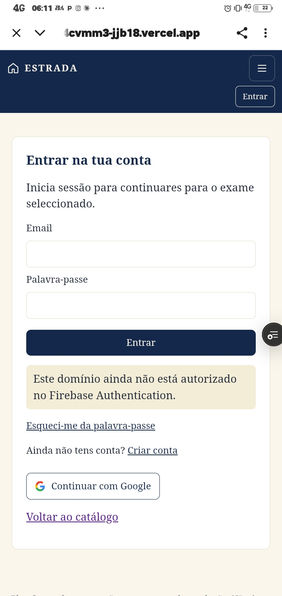
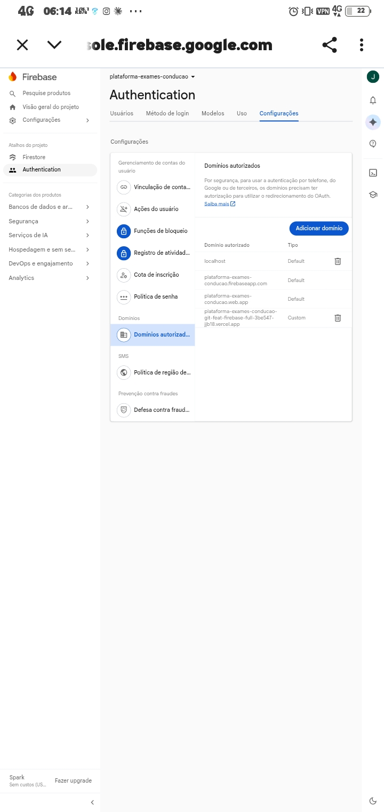

# Erro "domínio não autorizado" no Firebase Authentication (2026-11-17)

Os prints estão em PNG ao lado deste ficheiro. Como nem todas as ferramentas conseguem abrir imagens, o conteúdo está aqui **em texto**.

## Print 1 — `01-login-dominio-nao-autorizado.png`
Navegador do telemóvel, preview Vercel `...4cvmm3-jjb18.vercel.app` (URL do deploy, com hash).
Página ESTRADA, ecrã "Entrar na tua conta": texto "Inicia sessão para continuares para o exame seleccionado.", campos Email e Palavra-passe, botão "Entrar".
Mensagem de erro por baixo do botão: **"Este domínio ainda não está autorizado no Firebase Authentication."**
Também aparecem: "Esqueci-me da palavra-passe", "Ainda não tens conta? Criar conta", botão "Continuar com Google", "Voltar ao catálogo".

## Print 2 — `02-firebase-dominios-autorizados.png`
Firebase Console, projecto **plataforma-exames-conducao**, Authentication > Configurações > Domínios autorizados (plano Spark).
Domínios na lista:
| Domínio | Tipo |
|---|---|
| localhost | Default |
| plataforma-exames-conducao.firebaseapp.com | Default |
| plataforma-exames-conducao.web.app | Default |
| plataforma-exames-conducao-git-feat-firebase-full-3be547-jjb18.vercel.app | Custom |

## Leitura
O preview do print 1 tem um URL diferente do alias da branch autorizado no print 2, por isso o Firebase recusa o login.
Soluções: abrir o alias da branch `feat/firebase-full-migration` (já autorizado), ou adicionar o domínio do deploy em "Adicionar domínio". Cada deploy novo gera outro URL com hash, por isso o alias da branch é o mais estável.
